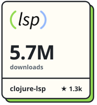
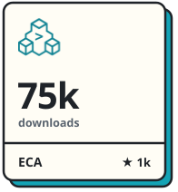
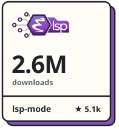
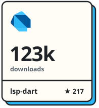

  <picture><source media="(prefers-color-scheme: dark)" srcset="profile/title-dark.svg" /></picture>

  <a href="https://clojure-lsp.io"><picture><source media="(prefers-color-scheme: dark)" srcset="profile/tile-clojure-lsp-dark.svg" /></picture></a>
  <a href="https://eca.dev"><picture><source media="(prefers-color-scheme: dark)" srcset="profile/tile-eca-dark.svg" /></picture></a>
  <a href="https://emacs-lsp.github.io/lsp-mode"><picture><source media="(prefers-color-scheme: dark)" srcset="profile/tile-lsp-mode-dark.svg" /></picture></a>
  <a href="https://emacs-lsp.github.io/lsp-dart"><picture><source media="(prefers-color-scheme: dark)" srcset="profile/tile-lsp-dart-dark.svg" /></picture></a>

  <a href="https://ericdallo.dev"><picture><source media="(prefers-color-scheme: dark)" srcset="profile/contact-website-dark.svg" /></picture></a>
  <a href="https://x.com/ericdallo"><picture><source media="(prefers-color-scheme: dark)" srcset="profile/contact-x-dark.svg" /></picture></a>
  <a href="https://www.linkedin.com/in/ericdallo"><picture><source media="(prefers-color-scheme: dark)" srcset="profile/contact-linkedin-dark.svg" /></picture></a>
  <a href="https://github.com/sponsors/ericdallo"><picture><source media="(prefers-color-scheme: dark)" srcset="profile/contact-sponsors-dark.svg" /></picture></a>
  <a href="https://www.patreon.com/ericdallo"><picture><source media="(prefers-color-scheme: dark)" srcset="profile/contact-patreon-dark.svg" /></picture></a>

